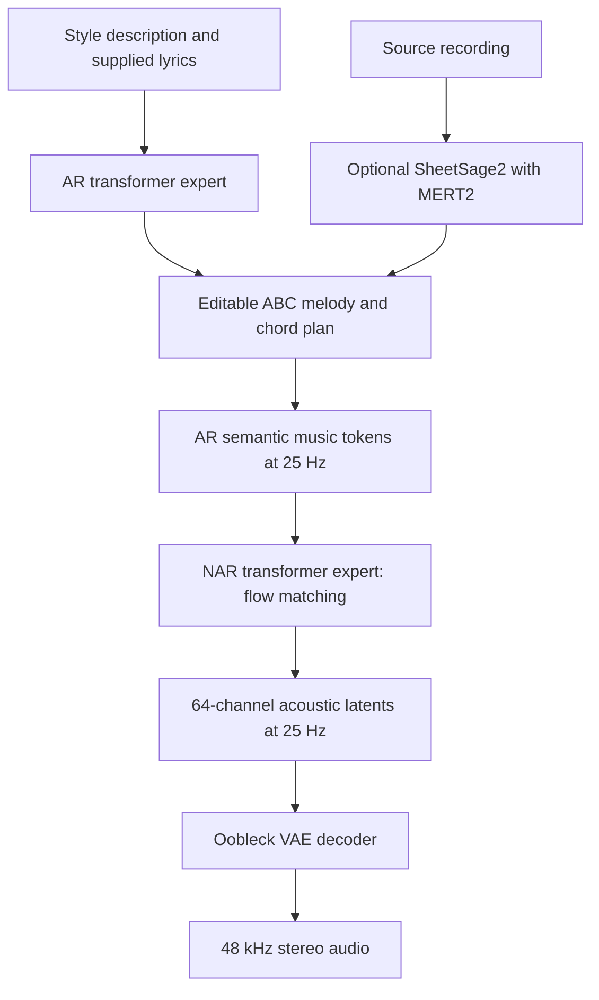

# YuE2 inspection for Cantor

Research date: **2026-11-09**. Scope: upstream documentation, source, configurations, model metadata, and existing native implementations. **No model weights were downloaded, no dependencies were installed, and no generation or listening tests were performed.** Timings below are attributed measurements, not measurements on this machine.

## Findings

YuE2 is a strong candidate for Cantor, especially for **editable composition and melody-preserving covers**. Normal generation needs two checkpoints: a **roughly 3.6-billion-parameter AR–NAR Mixture-of-Transformers (MoT)** and a **133-million-parameter VAE**. Their original weights total **7.792 GB**. Recording-to-cover adds SheetSage2 and its MERT2 encoder.

The most useful implementation finding is that **native C++ backends already exist**: [ServeurpersoCom/yue2.cpp](https://github.com/ServeurpersoCom/yue2.cpp) and [0xShug0/audio.cpp](https://github.com/0xShug0/audio.cpp). Audit these before writing a new port. The former shares an author and implementation lineage with the ACE-Step backend already in this folder.

## 1. Architecture: transformer, DiT, VAE?

The pipeline is:



**Does it have a DiT?** It has a bidirectional transformer expert doing the acoustic flow-matching job often assigned to a DiT. However, the released architecture unifies AR and NAR experts inside one MoT checkpoint; it does not require a separate standalone DiT checkpoint. Each of its 28 layers has separate AR/NAR attention projections, MLPs, and associated norms. Attention combines the appropriate paths through a hybrid visibility mask. [Backbone implementation](https://github.com/multimodal-art-projection/YuE/blob/1116bea76032bee5668e5f097294d082fa0b84f0/src/yue2/modeling_yue2.py)

| Component | Job | Needed for ordinary generation? |
|---|---|---|
| Text/ABC tokenizer | Qwen BPE from `qwen.tiktoken`; encodes descriptions, lyrics, and score text | Yes; a small vocabulary file, not a separate neural text encoder |
| AR expert | Writes the optional score, then one semantic token per audio frame | Yes |
| NAR expert | Conditions on the AR sequence and transforms Gaussian noise into acoustic latents | Yes; inside the same main model |
| Oobleck VAE | Convolutional encoder/decoder; generation uses its decoder | Yes |
| SheetSage2 | Transcribes recording melody, harmony, beats, key, and structure into a lead sheet | Only for covers starting from audio |
| MERT-v2-FullSong | Audio representation encoder automatically loaded by SheetSage2 | With SheetSage2; unnecessary for text/ABC generation |

The semantic vocabulary contains **32,768 codes**. A frame corresponds to **40 ms**; VAE upsampling is **1,920×**, giving 48,000 samples/s. The upstream acoustic solver uses **32 midpoint steps**, with two velocity evaluations per step. The VAE uses convolutions, transposed convolutions, and Snake activations; it is not another diffusion model. [Tokenization](https://github.com/multimodal-art-projection/YuE/blob/1116bea76032bee5668e5f097294d082fa0b84f0/src/yue2/tokenization_yue2.py), [protocol](https://github.com/multimodal-art-projection/YuE/blob/1116bea76032bee5668e5f097294d082fa0b84f0/src/yue2/protocol.py), [NAR solver](https://github.com/multimodal-art-projection/YuE/blob/1116bea76032bee5668e5f097294d082fa0b84f0/src/yue2/nar.py), [VAE implementation](https://github.com/multimodal-art-projection/YuE/blob/1116bea76032bee5668e5f097294d082fa0b84f0/src/yue2/modeling_vae.py).

MERT2 and SheetSage2 also supplied training supervision: semantic codes and symbolic scores derived from recordings. That training relationship does not make them extra inference requirements for a new song. [Technical paper](https://arxiv.org/html/2609.33757v1)

## 2. Size and actual files

Sizes are decimal GB/MB, obtained from Hugging Face API file metadata. Counts below are the API's stored tensor-element counts, which can include fixed buffers. VRAM figures elsewhere use the units reported by each source.

| Repository | Main weight file | Stored elements | Stored precision | Exact bytes | Approx. size |
|---|---|---:|---|---:|---:|
| `m-a-p/YuE2-3B` | `model.safetensors` | 3,630,684,224 | BF16 | 7,261,441,640 | 7.261 GB |
| `m-a-p/YuE2-Vae` | `model.safetensors` | 132,616,130 | FP32 | 530,512,720 | 530.513 MB |
| `m-a-p/YuE2-Vae-legacy` | `model.safetensors` | 132,616,130 | FP32 | 530,512,720 | 530.513 MB |
| `m-a-p/SheetSage2` | `model.safetensors` | 57,174,553 | FP32 on disk | 228,738,564 | 228.739 MB |
| `m-a-p/MERT-v2-FullSong` | `model.safetensors` | 632,429,312 | FP32 on disk | 2,529,812,848 | 2.530 GB |

Sources: [main model metadata](https://huggingface.co/api/models/m-a-p/YuE2-3B?blobs=true), [VAE metadata](https://huggingface.co/api/models/m-a-p/YuE2-Vae?blobs=true), [legacy VAE metadata](https://huggingface.co/api/models/m-a-p/YuE2-Vae-legacy?blobs=true), [SheetSage2 metadata](https://huggingface.co/api/models/m-a-p/SheetSage2?blobs=true), [MERT2 metadata](https://huggingface.co/api/models/m-a-p/MERT-v2-FullSong?blobs=true).

The main model's stored count includes a non-learned 24,576 × 2,048 sinusoidal position table. Subtracting that buffer gives approximately **3.580 billion learned parameters**; the stored checkpoint is commonly described as 3.6B. [Position-buffer implementation](https://github.com/multimodal-art-projection/YuE/blob/1116bea76032bee5668e5f097294d082fa0b84f0/src/yue2/modeling_yue2.py)

**Totals, weights only:** generation = **7.792 GB / 7.257 GiB**; adding audio transcription = **10.551 GB / 9.826 GiB**. Choose one VAE. Python environments, package caches, output files, and any derived serving checkpoint need additional disk space. SheetSage2 is an adapter/head release: its 229 MB download is not the complete transcriber by itself.

### Generation asset layout

| File | Role |
|---|---|
| Main `model.safetensors` | Both transformer experts and their auxiliary projections |
| Main `config.json` | Architecture dimensions and model-class mapping |
| `qwen.tiktoken` | Text/ABC tokenizer, 2,561,218 bytes |
| `yue2_generation_config.json` | Separate ABC/semantic sampling settings and acoustic solver defaults |
| `generation_config.json` | Transformers generation defaults |
| VAE `model.safetensors` + `config.json` | Waveform codec weights and configuration |
| `weights_manifest.json` in each model | Published weight size and SHA-256 |
| Runtime Python package | Pipeline, model implementations, tokenization, sampling, placement, and decoding |

There is no separate T5/CLAP/Qwen text-encoder checkpoint or RVQ depth-decoder checkpoint in the standard generation asset set. The resolver's explicit file list confirms this boundary. [Asset resolver](https://github.com/multimodal-art-projection/YuE/blob/1116bea76032bee5668e5f097294d082fa0b84f0/src/yue2/storage.py)

### Main configuration

28 layers; hidden width **2,048**; FFN width **6,144**; **16** attention heads; **8** KV heads; head dimension **128**; total vocabulary **184,704**; context **24,576** positions; RoPE theta **1,000,000**; latent dimension **64**. The “3B” name is rounded; it does not mean three billion parameters per expert. [Checkpoint config](https://huggingface.co/m-a-p/YuE2-3B/blob/8f24312f187763b9854adeec87e437e2b03bbff1/config.json)

The standard and legacy VAEs are alternative decoders. **Standard is the listening/generation default; legacy is required for the reported quality benchmark protocol.** Keep the upstream VAE in FP32. The default tiled decoder uses 1,024-frame cores and 16-frame halos. [Standard VAE](https://huggingface.co/m-a-p/YuE2-Vae), [legacy VAE](https://huggingface.co/m-a-p/YuE2-Vae-legacy).

## 3. Requirements and platform status

| Path | Requirements / evidence |
|---|---|
| Recommended upstream setup | Linux, Python 3.12, BF16-capable NVIDIA GPU with **24 GB VRAM**, one request at a time |
| Host memory | Upstream recommends **24 GB available RAM**; installed RAM must also accommodate the OS and other programs |
| Windows NVIDIA | Supported execution path; upstream documents two completed low-memory songs on an RTX 5060 Laptop 8 GB with a 6,000-token cap |
| AMD ROCm | Experimental PyTorch `cuda` path; documented attention checks do not establish full-song performance |
| Apple Silicon MPS | Experimental; native Mac acceptance pending in the inspected upstream revision |
| Intel XPU | Experimental; documented completed generation on Arc Pro B70 32 GB |
| CPU | Reference execution exists; no credible full-song timing found in the inspected upstream sources |

Low-memory mode stages AR/NAR modules and unloads the generator before VAE decoding. It requires host RAM and incurs transfers. The authors have not established stable full-length limits for every 6/8/12 GB GPU. A measured 11 GB peak on one song is therefore not a universal 12 GB requirement. [Hardware and validation guide](https://github.com/multimodal-art-projection/YuE/blob/1116bea76032bee5668e5f097294d082fa0b84f0/docs/hardware.md)

The inspected package pins PyTorch **2.10.0** outside macOS, **2.14.1** on macOS, Transformers **4.57.6**, Hugging Face Hub **0.36.2**, and Safetensors **0.7.0**. The optional fast stack pins vLLM **0.19.0** and Triton **3.6.0**. Although package metadata permits Python >=3.10, 3.12 is the documented generation starting point. [Package manifest](https://github.com/multimodal-art-projection/YuE/blob/1116bea76032bee5668e5f097294d082fa0b84f0/pyproject.toml)

For recording covers, upstream documents a **separate SheetSage2 environment** with Python 3.10/3.11, PyTorch/Torchaudio 2.8.0, and FFmpeg 6.1 shared libraries. Run transcription and generation sequentially to share one GPU. [Cover setup](https://github.com/multimodal-art-projection/YuE/blob/1116bea76032bee5668e5f097294d082fa0b84f0/docs/covers.md)

Experimental upstream FP8 quantizes only selected AR linear layers on NVIDIA compute capability >=8.9; the original BF16 weights are restored for acoustic conditioning. This is not a fully FP8 generator, and its source explicitly marks performance/quality validation as unvalidated. [Quantization implementation](https://github.com/multimodal-art-projection/YuE/blob/1116bea76032bee5668e5f097294d082fa0b84f0/src/yue2/quantization.py)

## 4. Generation speed

### Published upstream measurements

| GPU / route | Generated audio | Pipeline time | Audio seconds per compute second | Peak VRAM |
|---|---:|---:|---:|---:|
| RTX 4090, full planning | 214.85 s | **71.04 s** | 3.02× | 11.18 GiB |
| RTX 4090, melody planning | 214.67 s | 68.68 s | 3.13× | 11.02 GiB |
| RTX 4090, planning off | 196.88 s | 57.91 s | 3.40× | 11.09 GiB |
| H800, full planning | 224.96 s | 54.74 s | 4.11× | 10.34 GiB |

4090 rows average **32 warm requests per mode**. Runtime: PyTorch, CUDA graphs, FlashAttention, BF16 AR/NAR, FP32 standard VAE, no quantization. Timings cover synchronized pipeline calls, excluding initial path resolution and output saving. H800 is a one-song check. Maximum-context testing reached **14.08 GiB**. These are single-candidate timings and exclude source transcription. [Official speed table and conditions](https://huggingface.co/m-a-p/YuE2-3B#speed-and-resources)

### Other runtimes, measured separately

[YuE2-Turbo](https://github.com/NoizAI/YuE2-Turbo) reports RTX 5090 single-request RTF **0.173**, versus **0.290** for its reference path, using BF16 and 32 acoustic steps after warmup. That corresponds to approximately **41.5 seconds for four minutes** by linear extrapolation, not a separately measured four-minute result. Its four-request system RTF of 0.096 describes aggregate throughput. The service uses substantially more resident memory: about 18 GB at rest, under 25 GB in its reported four-way load.

[audio.cpp's GGUF publisher](https://huggingface.co/audio-cpp/Yue2-3B-GGUF#longform-performance) reports these RTX 5090 warm runs:

| Weights | Audio | Time | RTF | Peak VRAM |
|---|---:|---:|---:|---:|
| BF16 + F32 VAE | 224.96 s | 60.46 s | 0.2688 | 12,535 MiB |
| Q8_0 + F16 VAE | 194.84 s | 38.81 s | 0.1992 | 8,867 MiB |
| Q4_0 + F16 VAE | 221.12 s | 44.15 s | 0.1997 | 7,755 MiB |

These native runs produce different lengths and do not establish equal quality. Their longform table does not specify the solver-step count; the same card's demo commands use **8**, whereas upstream uses **32**. Do not interpret this table as a controlled speed comparison against the upstream 32-step path.

## 5. Generation controls and limitations

| Question | Answer for the standard upstream model |
|---|---|
| Text-conditioned? | Yes: music description + supplied lyrics |
| Score-conditioned? | Yes: supplied ABC melody or full melody-and-chord score |
| Automatic composition? | Yes: generates a score when planning is enabled |
| Automatic lyrics? | **No documented built-in lyric-writing task.** Lyrics are input; an external LLM/agent can write them first |
| Covers? | **Yes.** Transcribe a recording to ABC, review it, then render with target style and lyrics |
| Preserve melody but change arrangement? | Use chord-free ABC and `cot="melody"` |
| Preserve harmony too? | Supply the full score with `cot="full"` |
| Clone a reference singer? | No reference-speaker control in the standard request |
| Exact phonemes / per-section singers? | No dedicated controls; style descriptions provide softer guidance |
| Instrumentals? | Supported workflow uses empty lyrics and moves melody notes into the instrumental ABC voice; vocal leakage still needs listening checks |
| Edit notes, chords, key, tempo, form? | Yes, through the score; waveform timing and note realization remain generative |
| Local waveform inpainting? | Editing renders a new complete recording; unchanged sections are not guaranteed to retain their audio or singer |
| Separate instrument stems? | No native multi-stem output contract found. `Vocal` and `Ins` are score voices, not isolated audio stems |
| Direct arbitrary audio prompt? | Not a field in the standard generation request; audio covers use transcription first |

The API exposes `plan()` → `generate_semantic()` → `synthesize()` → `decode()`. Persisting intermediate stages allows score review, reuse, and re-decoding without generating a new song. The request schema supports `style`/`tags`, `lyrics`, `cot`, `abc`, `seed`, and `cfg_scale`; sampling overrides are separate. [Request schema](https://github.com/multimodal-art-projection/YuE/blob/1116bea76032bee5668e5f097294d082fa0b84f0/src/yue2/protocol.py), [pipeline](https://github.com/multimodal-art-projection/YuE/blob/1116bea76032bee5668e5f097294d082fa0b84f0/src/yue2/pipeline.py), [generation controls](https://github.com/multimodal-art-projection/YuE/blob/1116bea76032bee5668e5f097294d082fa0b84f0/docs/generation.md), [editing behavior](https://github.com/multimodal-art-projection/YuE/blob/1116bea76032bee5668e5f097294d082fa0b84f0/docs/editing.md).

Covers use the general generator without cover-specific fine-tuning. Transcription errors carry into the rendition. For translated lyrics, match phrasing and syllable counts to the melody. The authors' 948-work cover study reports CLEWS work-identity mAP **0.647** with full scores, **0.598** without chords, and **0.006** without scores. Retaining harmony favors identity; dropping chords gives more freedom for the requested style. [Cover workflow](https://github.com/multimodal-art-projection/YuE/blob/1116bea76032bee5668e5f097294d082fa0b84f0/docs/covers.md), [cover results](https://github.com/multimodal-art-projection/YuE/blob/1116bea76032bee5668e5f097294d082fa0b84f0/docs/cover-results.json).

## 6. Prompt format and languages

Use two fields: **`style` describes the sound; `lyrics` contains the words to sing**, with section tags such as `[Verse]` and `[Chorus]`. Include genre, instrumentation, vocal character, language, tempo, mood, and production preferences in the description. The protocol creates its own instruction and delimiters; callers do not need to handcraft a chat conversation. [Prompt protocol](https://github.com/multimodal-art-projection/YuE/blob/1116bea76032bee5668e5f097294d082fa0b84f0/src/yue2/protocol.py)

Original illustrative request, not an upstream test result:

```json
{
  "style": "Spanish, acoustic Latin pop, 94 BPM, warm expressive female lead, nylon-string guitar, soft percussion, intimate verses, uplifting chorus",
  "lyrics": "[Verse]\nLa tarde dibuja caminos de sal\nTu voz en el viento me invita a cantar\n[Chorus]\nVuelve la luz, vuelve a empezar\nLlevo tu nombre camino del mar",
  "cot": "full",
  "seed": 42
}
```

For a melody cover, change `cot` to `melody` and supply the transcribed chord-free `abc`. For direct generation without planning, use `cot="off"`. There is no separate free-form negative-prompt string in the inspected native request schema; `cfg_scale` adjusts guidance against a constructed negative branch.

**Language evidence has two levels:** the model card tags **English and Chinese**; the official demo data includes **Chinese, English, Japanese, Korean, Russian, and Spanish**. Spanish therefore has first-party demonstration evidence. This is not a guarantee of equal pronunciation, dialect coverage, or quality across six languages. The sources inspected do not provide an exhaustive support matrix for other languages. [Model-card language metadata](https://huggingface.co/m-a-p/YuE2-3B/blob/8f24312f187763b9854adeec87e437e2b03bbff1/README.md), [official demo cases](https://github.com/map-yue2/map-yue2.github.io/blob/99f999fc68f4a340d71c6a14689d83e644ec17f2/data/cases.js).

## 7. Length, defaults, and outputs

The default semantic cap is **9,000 tokens at 25 Hz**, approximately **six minutes**. The default score cap is **4,096 text tokens**. Songs can stop earlier; hitting the cap can leave a truncated song. The 24,576-position context also includes conditioning, so a cap is not a guaranteed usable duration on every device or request. There is no dedicated duration field in the inspected upstream `SongRequest`; native wrappers may add one by controlling token budgets. [Generation defaults](https://huggingface.co/m-a-p/YuE2-3B/blob/8f24312f187763b9854adeec87e437e2b03bbff1/yue2_generation_config.json), [request/context implementation](https://github.com/multimodal-art-projection/YuE/blob/1116bea76032bee5668e5f097294d082fa0b84f0/src/yue2/protocol.py).

`save_artifacts()` retains audio FLAC, score ABC when applicable, plan metadata, semantic tokens, FP32 latent arrays, effective settings, timings, model identities, hashes, and truncation indicators. Saved latents permit decoder comparisons. Seeds alone do not guarantee identical results across backends and runtimes. [Artifact implementation](https://github.com/multimodal-art-projection/YuE/blob/1116bea76032bee5668e5f097294d082fa0b84f0/src/yue2/pipeline.py)

## 8. Quality evidence against Cantor's existing families

Authors' WildSongBench results, 192 prompts:

| Setting | SongBench average ↑ |
|---|---:|
| YuE2, selected from eight | 6.9632 |
| YuE2, standard selection | 6.7316 |
| LeVo 2 | 6.3247 |
| MiniMax Music 3 | 6.2830 |
| ACE-Step 1.5 | 6.0118 |

“Standard” YuE2 selects from **two candidates**; a pipeline call generates one. The eight-candidate result adds generation and selection cost. These results use the **legacy VAE**, and baseline checkpoints/settings need not match Cantor's current local versions. Aggregate automatic scores and curated demos are grounds for evaluation, not proof that every generated song will sound better. [Benchmark methodology](https://github.com/multimodal-art-projection/YuE/blob/1116bea76032bee5668e5f097294d082fa0b84f0/docs/benchmarks.md), [machine-readable scores](https://github.com/multimodal-art-projection/YuE/blob/1116bea76032bee5668e5f097294d082fa0b84f0/docs/benchmark-results.json).

## 9. Existing C++ work and implications for Cantor

### ServeurpersoCom/yue2.cpp

[Standalone C++17/GGML implementation](https://github.com/ServeurpersoCom/yue2.cpp/tree/5a9500fd2979ab99fc82895877aadf8583acbabb), with server, CLI, score planning, optional native SheetSage2 transcription, and adapter support. README lists CPU/CUDA/Vulkan; build instructions also enable Metal on macOS. This is particularly relevant because this folder's `acestep.cpp` is from the same developer. Advertised backend availability still needs validation on Cantor's target devices.

Published files include:

| Artifact | Actual size |
|---|---:|
| `YuE2-3B-BF16.gguf` | 7.166 GB |
| `YuE2-3B-Q8_0.gguf` | 3.810 GB |
| `YuE2-3B-Q6_K.gguf` | 2.943 GB |
| `YuE2-3B-Q5_K_M.gguf` | 2.623 GB |
| `YuE2-Vae-F32.gguf` | 530.497 MB |
| Optional MERT Q8_0 + SheetSage2 Q8_0 | 902.284 MB + 105.630 MB |

The Q8 backbone plus F32 VAE totals **4.341 GB** on disk. The implementation can evict AR/NAR/VAE modules between stages, and includes reference-parity harnesses. Its optional community real-audio tokenizer adds semantic audio reconstruction/continuation workflows beyond the standard upstream score-cover route; those are separate assets and validation questions. [Architecture and parity documentation](https://github.com/ServeurpersoCom/yue2.cpp/blob/5a9500fd2979ab99fc82895877aadf8583acbabb/docs/ARCHITECTURE.md), [GGUF file metadata](https://huggingface.co/api/models/Serveurperso/YuE2-GGUF?blobs=true).

### audio.cpp

[YuE2 is already in main](https://github.com/0xShug0/audio.cpp/blob/7d20b414da088c3ffe56bd8803398d9d158cb847/docs/models/yue2.md), including ABC input/export, semantic export/continuation, AR/NAR LoRA loading, and parity probes. Its default layout uses Q8 main + F16 VAE with **four required sidecars**. The documentation reports NAR latent cosine >=0.9999 for BF16 and >=0.995 for Q8 in its stated probes; this is not complete audio-quality equivalence.

Its published main files are **7.261 GB BF16**, **4.264 GB Q8_0**, or **2.666 GB Q4_0**; the VAE is **265.219 MB F16** or **530.538 MB F32**. [File metadata](https://huggingface.co/api/models/audio-cpp/Yue2-3B-GGUF?blobs=true)

**The two GGUF families are not interchangeable by assumption.** They differ in naming, tokenizer/config packaging, tensor layout, and conversion choices. Serveurperso's converter omits a fixed positional buffer and reconstructs it; audio.cpp expects its sidecars. Keep each runtime paired with its own conversion. Also specify acoustic steps explicitly during comparisons: the inspected audio.cpp option table lists an 8-step fallback, while the upstream and standalone implementation use 32.

### Suggested integration direction — assessment, not implemented

Audit the standalone port first for reuse with Cantor's existing GGML infrastructure, and use audio.cpp as a second implementation reference. The local MiniMax implementation report already records adapting audio.cpp, which makes that route relevant too. A natural model inventory is **main MoT + VAE**, with an optional **MERT + SheetSage2** transcription bundle.

Expose the score as a retained artifact and a user-supplied condition. Preserve separate planning, semantic, acoustic, and decode boundaries for progress, cancellation, and future resume support. Keep lyric writing as an external LLM feature. Before adopting either port, compare tokenizer IDs, AR logits, fixed-input NAR latents, and VAE output against a pinned upstream reference; then measure long-song memory and listen to English/Spanish generations and covers. No Cantor source or backend repository was changed for this inspection.

## 10. License implications

Current upstream **code, documentation, and agent skill are Apache 2.0**. Weights are **CC BY-NC 4.0**, with an additional permission in the current repository for individual creators to monetize outputs without model fees. That permission explicitly excludes commercial company use of the model weights and commercial weight redistribution. A company shipping or serving YuE2 through Cantor should resolve that model-license scope with the authors. [Current model terms](https://github.com/multimodal-art-projection/YuE/blob/1116bea76032bee5668e5f097294d082fa0b84f0/MODEL_LICENSE), [source license](https://github.com/multimodal-art-projection/YuE/blob/1116bea76032bee5668e5f097294d082fa0b84f0/LICENSE).

The inspected Hugging Face checkpoint LICENSE contains the base CC BY-NC text without the repository's additional creator section. Retain both the exact checkpoint terms and the current upstream grant when assessing distribution. A native conversion does not remove weight-license conditions; optional community assets and dependencies have their own terms. [Checkpoint license](https://huggingface.co/m-a-p/YuE2-3B/blob/8f24312f187763b9854adeec87e437e2b03bbff1/LICENSE)

## 11. Inspection revisions

| Resource | Inspected revision |
|---|---|
| Official YuE source | `1116bea76032bee5668e5f097294d082fa0b84f0` |
| YuE2-3B | `8f24312f187763b9854adeec87e437e2b03bbff1` |
| YuE2-Vae | `152733a19ad43aa67e367f9b5503ef8075bb5126` |
| YuE2-Vae-legacy | `d0585a9cdbb36e8b6930046974500ad7078317ca` |
| SheetSage2 | `b83c3d79a6d98bcffaf8f9ed112c90aa887887bc` |
| MERT-v2-FullSong, current metadata | `7001f7657276238629e61c7746ce70735e0604c0` |
| Official demo source | `99f999fc68f4a340d71c6a14689d83e644ec17f2` |
| ServeurpersoCom/yue2.cpp | `5a9500fd2979ab99fc82895877aadf8583acbabb` |
| Serveurperso/YuE2-GGUF | `e630f2b8f6aedf8254c3186438633c1b5eeaf80a` |
| audio.cpp | `7d20b414da088c3ffe56bd8803398d9d158cb847` |
| audio-cpp/Yue2-3B-GGUF | `cca74d8980c00f30ab8d52248a367c01ad633ec2` |

SheetSage2's config separately pins its MERT parent to `d8ba1c745e733b3908ce6ad16ebeb17ac7600a42`; the current parent metadata row above is not an instruction to override that dependency. The audio.cpp GGUF card names an older original-model revision, `1a96eca688d6ae5d7f0feb88573fec89920fcd19`. Those differences should be preserved in any subsequent parity assessment.
